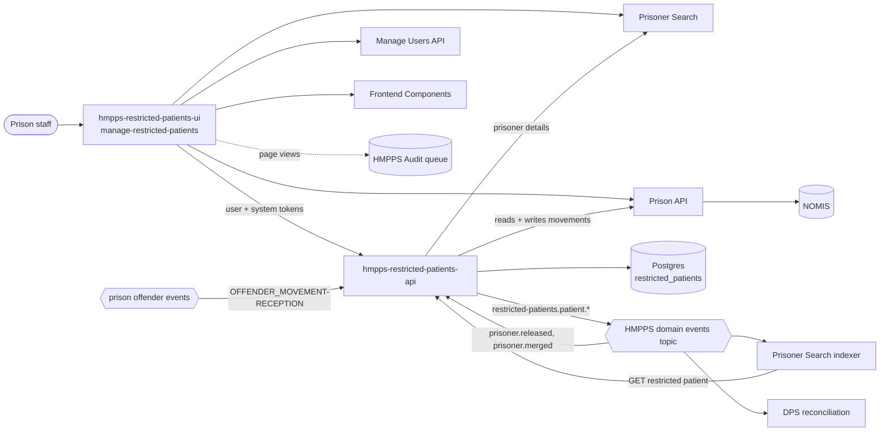

# Architecture

How Restricted Patients is put together: the two applications, the services they depend on, the
data the API holds, and the events it sends and receives. For what happens step by step in each
journey see [business-flows.md](business-flows.md).

## The pieces

| Component | Repository | Language | Role |
|---|---|---|---|
| UI | [hmpps-restricted-patients-ui](https://github.com/ministryofjustice/hmpps-restricted-patients-ui) | TypeScript, Express, Nunjucks | Staff-facing service. Five journeys, each needing a role (see below). |
| API | this repository | Kotlin, Spring Boot | Holds the list of restricted patients, writes the hospital movements to NOMIS through Prison API, publishes domain events, runs the nightly clean-up. |

Both run in Cloud Platform namespaces `hmpps-restricted-patients-{dev,preprod,prod}`. Hostnames,
infrastructure and alerting are in [deployment.md](deployment.md).

## What the API stores, and what it doesn't

The API has one table, `restricted_patients`, with one row per prisoner who is currently a
restricted patient:

| Column | Meaning |
|---|---|
| `prisoner_number` | Primary key. NOMIS prisoner number (e.g. `A1234BC`). |
| `from_location_id` | Prison the prisoner was discharged from. |
| `hospital_location_code` | NOMIS agency code of the hospital (agency type `HOSPITAL` or `HSHOSP`). |
| `supporting_prison_id` | Prison responsible for the patient (where the Prison Offender Manager sits). Defaults to `from_location_id`. |
| `discharge_time` | When the prisoner left for hospital. |
| `comment_text` | Free text, up to 240 characters. |
| `create_*`, `modify_*` | Who and when, filled in by JPA auditing from the caller's token (null for event and batch work). |

The schema is four Flyway migrations in `src/main/resources/db/migration` (V1 to V4); there have
been no schema changes since 2021. When a patient stops being a restricted patient the row is
**deleted**, so the table holds current patients only. There is no history table.

Everything else is fetched when needed:

- **NOMIS, through Prison API** is the system of record for the movement itself. The API reads
  bookings, latest movements and agency (prison and hospital) details, and writes the
  discharge-to-hospital and release movements.
- **Prisoner Search** supplies booking id and sentence data (conditional release date, sentence
  expiry date, recall, indeterminate sentence, legal status) for removals and the nightly job.

## Who else depends on this service

| Consumer | How | Why |
|---|---|---|
| Prisoner Search indexer (`hmpps-prisoner-search`) | Listens for the three `restricted-patients.patient.*` events, then calls `GET /restricted-patient/prison-number/{no}` | Keeps the restricted patient details (hospital, supporting prison) on the prisoner's search record. The UI's "view" and "remove" searches read this index, not the API. |
| DPS reconciliation (`hmpps-dps-reconciliation`) | Listens for the events | Reconciliation between DPS and NOMIS. |

Because search is updated from the events, a change made directly in the database is not seen by
search or the UI until the prisoner is re-indexed. See [runbook.md](runbook.md).

## API endpoints

| Method and path | Used by | Role needed | What it does |
|---|---|---|---|
| `POST /discharge-to-hospital` | UI, move to hospital | `ROLE_TRANSFER_RESTRICTED_PATIENT` | Creates the record and asks Prison API to discharge the prisoner to hospital in NOMIS. |
| `POST /migrate-in-restricted-patient` | UI, add a released prisoner | `ROLE_RESTRICTED_PATIENT_MIGRATION` | Creates the record for someone already released to hospital in NOMIS. |
| `GET /restricted-patient/prison-number/{no}` | Search indexer, UI remove | `ROLE_RESTRICTED_PATIENTS__RO` or `ROLE_REMOVE_RESTRICTED_PATIENT` (see below) | Returns the record with prison and hospital descriptions; 404 if not a restricted patient. |
| `DELETE /restricted-patient/prison-number/{no}` | UI, remove | `ROLE_REMOVE_RESTRICTED_PATIENT` | Deletes the record and books a release movement in NOMIS. |
| `POST /change-supporting-prison` | UI, change supporting prison | `ROLE_RESTRICTED_PATIENT_MIGRATION` | Changes the supporting prison. Database only, nothing is written to NOMIS. |
| `GET /subject-access-request` | HMPPS SAR service | `ROLE_SAR_DATA_ACCESS` | Subject access request data. |
| `/queue-admin/*` | Support | `ROLE_SYSCON__QUEUE_ADMIN` | Dead letter queue tools from `hmpps-sqs`. |

The write endpoints need the same role as the UI journey that calls them, so they must be called
with the user's own token. Every endpoint must carry a `@PreAuthorize`; `ResourceSecurityTest`
fails the build if one does not.

The `GET` endpoint accepts either of two roles. The prisoner search indexer calls it with a system
token whose client holds `ROLE_RESTRICTED_PATIENTS__RO`. The UI's remove journey calls it with the
user's own token, so it also accepts that journey's role, `ROLE_REMOVE_RESTRICTED_PATIENT`. Legacy
DPS (`digital-prison-services`) used to call it with any member of staff's token; that call was
removed in October 2026 (MAPB-1052).

Swagger is published in dev only:
<https://restricted-patients-api-dev.prison.service.justice.gov.uk/swagger-ui/index.html>.

Validation failures return 400 with an `errorCode`: `EXISTING_PATIENT`, `NO_MOVEMENTS`,
`MULTIPLE_MOVEMENTS`, `LAST_MOVE_NOT_REL`, `LAST_MOVE_NO_FROM_AGENCY`, `PRISON_UNCHANGED`,
`PRISON_NOT_FOUND`, `DISCHARGE_TIME_INVALID`. An error from Prison API or Prisoner Search
comes back as 500 with `UPSTREAM_ERROR`.

## Tokens and identity

The API uses two Prison API clients (`config/WebClientConfig.kt`):

- **User client.** Used for writes made during an HTTP request. It asks HMPPS Auth for a client
  credentials token *with the caller's username*, so the NOMIS movement is recorded against the
  member of staff.
- **System client.** Used for all reads, and for writes when there is no HTTP request (event
  listeners and the nightly job). `PrisonApiUpdateService` chooses between them.

The UI calls the API with the user's own token. Prisoner photos and prisoner details are fetched
with a system token.

### UI roles

| Role | Journey |
|---|---|
| `ROLE_TRANSFER_RESTRICTED_PATIENT` | Move a prisoner to hospital |
| `ROLE_SEARCH_RESTRICTED_PATIENT` | View restricted patients |
| `ROLE_REMOVE_RESTRICTED_PATIENT` | Remove from restricted patients |
| `ROLE_RESTRICTED_PATIENT_MIGRATION` | Add a released prisoner, and change supporting prison |

The home page shows a tile for each journey the user has a role for. A user without the role
who goes straight to a journey URL gets the "page not found" page. The help pages in the UI
mention only the first three roles.

## Events

### Published (SNS, HMPPS domain events topic)

| Event | When |
|---|---|
| `restricted-patients.patient.added` | After discharge or migrate-in, and when a discharge done directly in NOMIS is picked up. |
| `restricted-patients.patient.removed` | After a manual removal, each removal by the nightly job, and when a patient is received back into prison. |
| `restricted-patients.patient.supporting-prison-changed` | After a supporting prison change. |

Payload: `eventType`, `version` (1), `occurredAt`, `publishedAt`, `description`,
`additionalInformation.prisonerNumber` and `personReference.identifiers[NOMS]`. The schemas are in
[hmpps-domain-events](https://github.com/ministryofjustice/hmpps-domain-events) and described by
[async-api.yml](../async-api.yml).

Events from HTTP requests are published by the controller **after** the database transaction
commits. If publishing fails the caller sees a 500, but the database and NOMIS changes stand and
no event goes out.

### Consumed

| Queue (`hmpps-sqs` id) | Event | What the API does |
|---|---|---|
| `offenderevents` (prison offender events) | `OFFENDER_MOVEMENT-RECEPTION` | If the prisoner is a restricted patient, deletes the row and publishes `removed`. No NOMIS call; the reception is already in NOMIS. |
| `domainevents` | `prisoner-offender-search.prisoner.released` with reason `RELEASED_TO_HOSPITAL` | Picks up a discharge to hospital done directly in NOMIS (see [business-flows.md](business-flows.md#discharge-done-directly-in-nomis)). |
| `domainevents` | `prison-offender-events.prisoner.merged` | Detection only. If either record is a restricted patient it throws, so the message ends up on the dead letter queue for someone to sort out by hand. See [runbook.md](runbook.md#a-restricted-patient-has-been-merged). |

Failed messages are retried with back-off (1, 10, 60, 600 seconds) and move to the dead letter
queue after 5 attempts. Nothing moves them back automatically: the `retry_dlqs` cron job was
removed in March 2026 (SDIT-3616). The SNS subscriptions and filter policies are defined in
cloud-platform-environments, not here.

## Nightly clean-up job

A Kubernetes CronJob, `past-date-check`, starts the API image in batch mode
(`batch.enabled=true`, `batch.type=PAST_DATE_CHECK`). It runs at 03:00 in preprod and prod, and
at 15:00 on weekdays in dev. Batch mode removes the queue listeners so the job pod does not take
messages from the queues.

The job (`BatchReleaseDateRemoval`) removes restricted patients whose custody has ended:

- not on an indeterminate sentence, **and**
- either not recalled, sentenced, and past their **conditional release date**,
- or recalled (legal status `SENTENCED` or `RECALL`) and past their **sentence expiry date**.

Each removal books a release movement in NOMIS and publishes `removed`. One failure is logged and
does not stop the rest. Telemetry event `restricted-patient-batch-removal` lists the prisoner
numbers removed.

## UI notes

- Sessions and system tokens are held in Redis (ElastiCache).
- Every page view is sent to HMPPS Audit (`PAGE_VIEW`, `PAGE_VIEW_ACCESS_ATTEMPT`) since MAPB-1039,
  October 2026. Search terms are recorded as the audit subject, never in the page URL.
- The user's UUID is added to App Insights telemetry from the token (`setUpCurrentUser`, MAPB-1038).
- The header and footer come from the DPS frontend components service, with a fallback if it is
  down.
- Health (`/health`) checks HMPPS Auth, Manage Users, token verification, Prison API, Prisoner
  Search and the Restricted Patients API. Redis and the components service are not checked.

## Telemetry worth knowing

Custom events in App Insights (`cloud_RoleName == 'hmpps-restricted-patients-api'`):

| Event | Raised by |
|---|---|
| `restricted-patient-added-discharge` | Move to hospital |
| `restricted-patient-added-migrate` | Add a released prisoner |
| `restricted-patient-removed` | Manual removal |
| `restricted-patient-removed-cleanup` | Received back into prison |
| `restricted-patient-batch-removal` | Nightly job (lists prisoner numbers) |
| `restricted-patient-changed-supporting-prison` | Change supporting prison |
